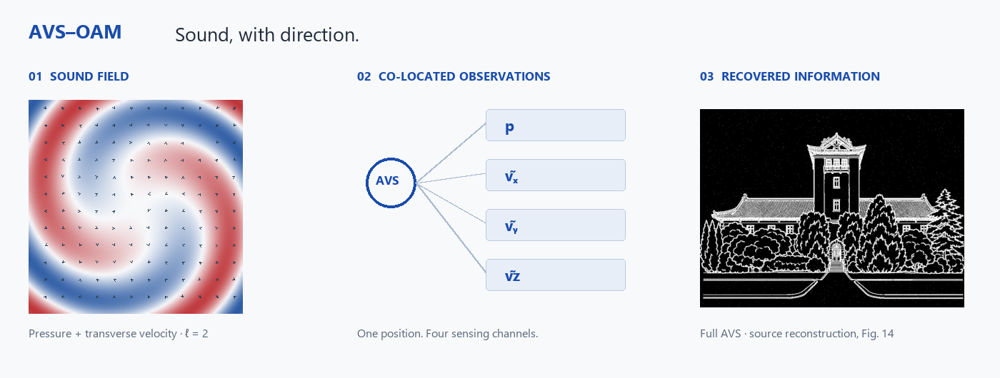
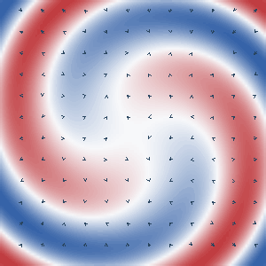

# AVS-OAM

**Sound, with direction.** Cartesian acoustic-vector-sensor (AVS) reception for sparse-aperture acoustic orbital-angular-momentum (OAM) communication.

[](https://brianzhu1999.github.io/AVS-OAM/)

### [Open the interactive research explorer →](https://brianzhu1999.github.io/AVS-OAM/)

Explore the field, inspect the receiver, and compare the recovered information. The project website is in English and includes:

- **OAM field explorer:** four modes, phase playback and transverse-velocity arrows from the manuscript's complex field arrays.
- **Co-located receiver:** selectable sensing points, four complex channels and the corresponding receiving-matrix rows.
- **Codeword geometry:** linked selection across three reception strategies, projection multiplicities and full-space nearest-neighbor distances.
- **Performance explorer:** original SNR, offset, distance, finite-pilot and hardware-error sweeps, with discrete settings and CSV downloads.
- **Payload recovery:** shared magnification, bit-error overlays and symbol-order playback of the actual decoded image arrays.
- **Two downloadable MP4 animations** and a **15-figure atlas**, with source provenance and asset-generation scripts.

<p align="center"><a href="https://brianzhu1999.github.io/AVS-OAM/#field"></a></p>

*Normalized instantaneous pressure and transverse velocity for ℓ = 2. The interactive page gives the axes, display scales and physical settings. [Field video](https://brianzhu1999.github.io/AVS-OAM/assets/field-cycle.mp4) · [Recovery video](https://brianzhu1999.github.io/AVS-OAM/assets/recovery.mp4)*

The code accompanies the study *Acoustic Vector-Sensor Reception for Orbital-Angular-Momentum Sound Communication* and provides executable examples of the finite-ring forward model, pressure-equivalent particle-velocity channels, receiving-matrix analysis, BPSK detection, receiver-offset mismatch, and a gapped-aperture payload.

## Components

- `avs_oam_core.py` - finite-ring OAM field model, Cartesian pressure-equivalent velocity channels, observation selection, column normalization, matrix diagnostics, and maximum-likelihood BPSK helpers.
- `matrix_observability.py` - compares pressure-only, transverse-AVS, and full Cartesian-AVS receiving matrices for full, gapped, and random sparse apertures.
- `known_bpsk_snr.py` - evaluates known-mode BPSK bit-error rate over a range of SNR values.
- `offset_robustness.py` - evaluates BER under receiver-position mismatch with a nominal detector channel.
- `gap_payload_demo.py` - evaluates binary payload recovery through a sparse gapped receiver.

## Requirements

- Python 3.10 or newer
- NumPy

Create an environment and install the dependency:

```bash
python -m venv .venv
.venv\Scripts\activate
python -m pip install -r requirements.txt
```

On macOS or Linux, activate the environment with:

```bash
source .venv/bin/activate
```

## Run the examples

```bash
python matrix_observability.py
python known_bpsk_snr.py
python offset_robustness.py
python gap_payload_demo.py
```

Each example writes a CSV result file in the current directory.

## Model convention

The default configuration in `OAMConfig` uses a 16-element finite source ring at 3430 Hz, with a 0.12 m source radius, a 0.12 m receive radius, and a nominal propagation distance of 1.2 m. The observation vector is ordered as

```text
[pressure, rho0*c0*vx, rho0*c0*vy, rho0*c0*vz]
```

The examples use the same column-normalization convention for comparing observation modes. Change the configuration and mode sets in the example scripts to explore other sparse-aperture conditions.

## Reproducibility

The examples use explicit NumPy random seeds. Numerical settings such as frame counts and scan grids are defined directly in each example script.

The root-level examples are compact model demonstrations. The website's quantitative performance curves use the recorded study runs; each source table records its normalization, whitening, calibration and repetition settings. See [data and model conventions](docs/DATA.md) and the [source manifest](docs/data/source_manifest.json).

To rebuild the website assets and run the scientific data checks:

```bash
python -m pip install -r tools/requirements-site.txt
python tools/export_site_data.py
python tools/export_media.py
python tools/verify_site_data.py
python -m http.server 8767 --directory docs
```

Open `http://127.0.0.1:8767/`; stop the local server with Ctrl+C. GitHub Pages serves the `docs/` directory. The static site has no backend or external JavaScript dependency.

## Citation

If you use this code, please cite the accompanying paper and include the repository URL in your methods or software statement.

